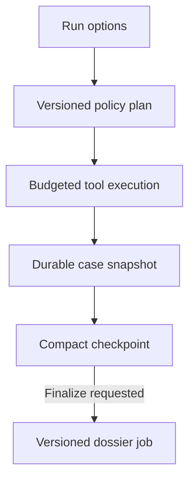
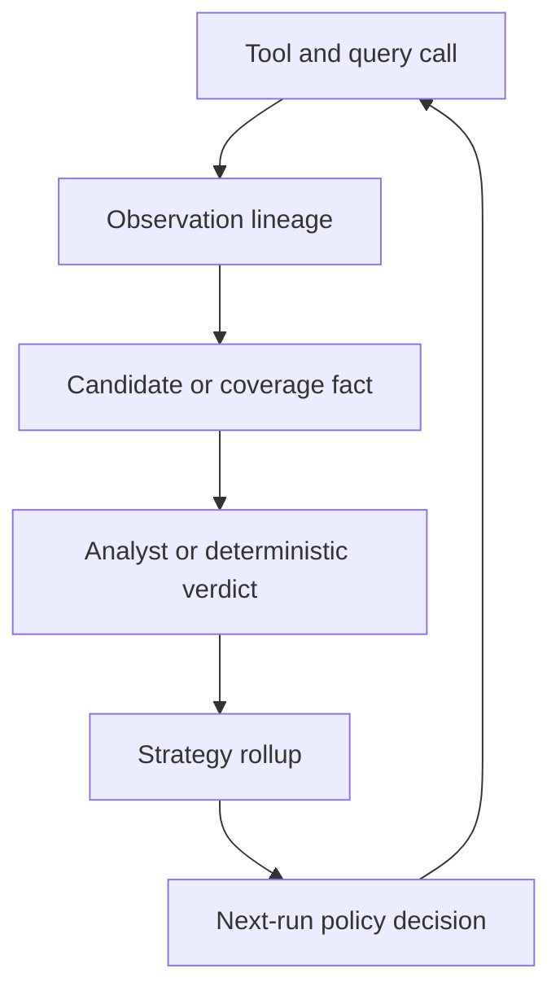

# Insight Finder: Adaptive Runtime and Product Stability Roadmap

**Decision document — 2026-09-12**  
**Baseline:** canonical `main` at `30301344`; live `osint-agent` build `2864860`  
**Scope:** staged redesign plan, not an implementation or deployment

## Executive decision

Insight Finder should stop behaving like a chat model that narrates every tool call and repeatedly rewrites a growing dossier. It should become an **evidence-delta engine**:

1. A scan starts from explicit options, including whether case memory may be recalled.
2. A deterministic policy chooses a small, high-value workflow.
3. Tool events update one durable case snapshot and one compact progress surface.
4. Observations are separated from claims, promoted evidence, and coverage facts.
5. Analyst verdicts and measured downstream yield improve future source, query, and workflow selection.
6. A dossier is generated only when requested, once per case revision, from persisted evidence—not retyped from chat history.

The default new-case experience should be **Quick + Fresh memory + no automatic dossier**. Strategy intelligence remains active in every mode because it contains aggregate lessons about source and workflow performance, not subject-specific memories.

The current product metric is pointed in the wrong direction. An eight-minute run that creates 123 rows to sort is not successful because it “found” 123 artifacts. It is unsuccessful unless it produced a small number of defensible, useful findings. The north star should be **time to first analyst-accepted finding**, guarded by validated precision, completion rate, and review burden.

## What is already real—and should be kept

The codebase is not starting from zero. Recent work established foundations that this roadmap should extend rather than replace:

- server-side tool budgets, concurrency limits, outcome logging, cache instrumentation, and per-run duplicate/no-yield suppression;
- analyst rejection as durable authority across dispatch, memory, graph, and report paths;
- promotion quarantine for unproven subject linkage;
- an append-only analyst feedback stream and confidence-calibration functions;
- a case-snapshot direction, interrupted-run handling, safer exports, pivot validation, composer preflight, and a calmer shell in [PR #578](https://github.com/justindean785/insight-finder/pull/578);
- a current truth-boundary cleanup for report, print, and Tools in [PR #579](https://github.com/justindean785/insight-finder/pull/579), which should be reviewed and either merged or explicitly superseded before overlapping work begins.

Those are useful controls. The missing layer is a coherent product contract connecting them.

## Audit: why the experience is still slow and noisy

### 1. The prompt gives the agent incompatible instructions

The current prompt asks for a small, high-value batch and diminishing-return stopping, while also making memory recall, breach/dark-web sweeps, multiple specific sources, legal dorks, correlation, and final memory actions mandatory across broad classes of investigations. A model cannot optimize a budget while also being told that most branches are compulsory. Current model guidance also warns that blanket “must use this tool” language can cause over-triggering; conditional policies are more reliable ([Anthropic tool-use guidance](https://docs.anthropic.com/en/docs/agents-and-tools/tool-use/implement-tool-use)).

**Decision:** move coverage requirements out of prose and into versioned Quick, Standard, and Deep policies. The model may propose work; the server owns eligibility, budget, and stopping rules.

### 2. Chat is carrying state, telemetry, and reporting at the same time

`ChatWindow.tsx` is roughly 137 KB and has to reconcile prose, streamed tool parts, cycle summaries, progress, older reports, and recovery state. Individual tool details may be collapsible, but every cycle still occupies transcript space. The user sees orchestration traffic instead of an investigation.

**Decision:** chat contains only user messages, one live run card, checkpoint answers, and the latest final report reference. The case snapshot—not the concatenated assistant transcript—is canonical state.

### 3. “Memory” mixes unrelated concepts

`agent_memory` currently mixes identity, connection, pattern, and lesson records in one free-text-oriented store. Recalling it consumes an extra agent/tool step and injects history whether or not a clean investigation needs it. At the same time, the Brain/Sources UI derives “reliability” from raw `ok`, even though intentional skips can be `ok:true` and a genuine no-record result is not a failure.

**Decision:** separate subject/case memory, immutable analyst authority, aggregate strategy intelligence, and provider health. Make only subject/case recall optional.

### 4. The runtime measures execution, not intelligence yield

The current health view can measure execution reliability and latency. It cannot answer the questions that should drive future plans:

- Did this call create a relevant candidate?
- Was that candidate promoted, confirmed, dismissed, or duplicated?
- Did the source add independent information?
- Did a query template or workflow improve the case?
- How much time and money were spent per accepted finding?

Without a call-to-artifact lineage link, a learner would optimize whatever is easiest to measure—often successful HTTP responses or row volume—and make the product noisier.

**Decision:** do not activate adaptive suppression until lineage and outcome truth are complete.

### 5. Empty, unavailable, and false-positive results are not the same

A source returning no record can be valuable negative coverage. A parser receiving malformed JSON inside HTTP 200 is an execution failure. A returned claim shown to be about the wrong subject is a false positive. Those outcomes must not share one boolean. The open malformed-response work in [issue #494](https://github.com/justindean785/insight-finder/issues/494) is therefore a dependency of—not a side task beside—the learner.

### 6. The report path rebuilds too much, too often

The model currently receives or recreates a large dossier as the thread grows. Previous attempts to simply remove finalization broke completion because scan termination and report existence were coupled. Separately, the model can retype confidence and source counts that disagree with the server-side evidence ledger; the current warning is documented in [`CLAUDE.md`](https://github.com/justindean785/insight-finder/blob/30301344debb098fe8616149b0e33ff5e6739bfb/CLAUDE.md#the-report-layer-bypasses-the-integrity-engine-2026-08-11).

**Decision:** split scan completion from report completion and server-render evidence-authoritative report sections.

### 7. Reliability controls do not survive a run

The circuit breaker is thread-local and in memory. Some provider errors suppress a family within a run, while 502/504 currently disable only the calling tool. The next investigation relearns the same operational failure. Durable cancel/resume/idempotency is also missing, so long work remains attached to one request lifecycle. The open request-global-state defect is tracked in [issue #63](https://github.com/justindean785/insight-finder/issues/63).

### 8. Critical behavior is under-gated in pull requests

The repository has strong unit and edge suites, but the e2e workflow currently runs after pushes to `main`, not as a PR gate. A real workspace regression passed unit, typecheck, lint, build, and edge checks before e2e caught it. This roadmap treats behavioral e2e as a release contract, not optional polish.

## Product contract

### Investigation modes

These are initial service-level objectives to validate against a sanitized replay suite, not promises to hard-code before measurement.

| Mode | Intended use | Initial budget | Report behavior | Stop rule |
| --- | --- | ---: | --- | --- |
| **Quick** (default) | Rapid triage and next best leads | 8–12 calls; target 60–90s | No automatic dossier | Stop after two low-marginal-yield cycles or a decisive result |
| **Standard** | A normal defensible investigation | 20–24 calls; target 3–4 min | Checkpoint only; finalize on request | Stop on exhausted high-value branches or low expected gain |
| **Deep** | Exhaustive, resumable case work | Durable job with explicit budgets | Versioned dossier may be queued | Checkpoint and resume; never one long edge request |

The server enforces these modes. Appending “be quick” to a prompt is not enforcement.

### Memory control

The first-run UI should expose one understandable control:

> **Use prior case memory** — Off by default for a new investigation; On by default when continuing an existing case.

Internally it maps to three precise modes:

| Internal mode | User situation | Loaded context |
| --- | --- | --- |
| `fresh` | New subject or clean-room check | No previous subject identity/narrative memory |
| `relevant` | New run where previous exact-seed lessons may help | Top few non-rejected, high-confidence exact-seed memories |
| `continue` | Resume an existing case | Current case snapshot, analyst decisions, and unresolved leads |

Three rules matter:

1. **Strategy intelligence always applies.** Fresh mode still benefits from aggregate source/query/workflow performance without receiving prior subject PII.
2. **Current analyst authority always applies.** Dismissals, quarantine, and safety decisions are not optional memories.
3. **Recall becomes a server prefetch, not an agent turn.** It gets a strict latency and size budget and is recorded in run telemetry. This isolates whether the real cost is database lookup, an extra model step, or injected prompt size.

The UI may later expose all three labels to advanced users. The initial two-state control keeps the product understandable.

### Run and report lifecycle

Persist separate state machines:

- `scan_status`: `queued | running | paused | completed | failed | cancelled`
- `report_status`: `not_requested | queued | generating | ready | failed | stale`

A scan can complete honestly without a dossier. Evidence added after finalization marks the report stale with a revision delta; it does not regenerate automatically.

## Adaptive intelligence: how the system should actually learn

### Separate four kinds of knowledge

| Store | Scope | Examples | Read policy |
| --- | --- | --- | --- |
| **Case memory** | Subject/case specific | identity links, unresolved leads, previous narrative | Optional by memory mode |
| **Analyst authority** | Current user/case truth | dismissed artifact, confirmed linkage, quarantine release | Always enforced |
| **Strategy intelligence** | Aggregated and de-identified | source yield by selector; dork template precision; workflow utility | Always used by planner |
| **Provider health** | Operational | endpoint errors, throttling, latency, breaker state | Always used by runtime |

Do not let the language model directly write production weights. It may suggest a lesson; deterministic aggregation of observed outcomes decides whether that lesson changes policy.

### Minimum event and lineage model

Add or extend these records:

#### `investigation_runs`

- `id`, `thread_id`, `user_id`, timestamps, status, and case revision;
- normalized `seed_type`, objective, investigation mode, memory mode, report mode;
- model/provider, prompt version, policy/workflow version;
- call, cost, prompt-token, context-byte, and duration totals;
- completion, recovery, cancel, and failure reason.

#### `tool_usage_log` additions

- `run_id`, stable `call_id`, provider family and endpoint version;
- selector type—not raw selector value for cross-case analytics;
- `query_template_id`, `workflow_id`, step/phase, and decision reason;
- normalized outcome: `usable | no_record | duplicate | skipped | blocked | malformed | timeout | upstream_error`.

#### `artifact_tool_lineage`

A junction table linking each `tool_call_id` to zero or more `artifact_id` values with lineage type. Do not store artifact IDs in an array on the call row; the junction must support joins, constraints, and corrections.

#### `coverage_observations`

Persist checked-and-clear or checked-but-unavailable coverage without promoting it as evidence about the subject. A zero-result breach check belongs here, not in the analyst’s artifact triage queue.

#### `strategy_policy_stats`

Rollups keyed by a versioned context such as:

`provider family + endpoint version + selector type + query template + objective + workflow version`

Never key cross-case learning on raw email addresses, phone numbers, names, or usernames.

### Outcomes the learner should optimize

- analyst-confirmed or promoted artifact yield;
- validated false-positive rate;
- independent-source information gain;
- duplicate and already-known rate;
- no-record coverage rate;
- cost and latency per accepted finding;
- time to first accepted finding;
- investigation completion and recovery rate;
- downstream contribution to a confirmed relationship or report finding.

The raw number of artifacts is a diagnostic, not a success metric.

### The learning loop

The feedback stream already provides a useful immutable substrate. The new work is connecting verdicts back to the calls, query templates, and workflow versions that produced the artifacts.

### Implement the “15 false positives” rule safely

The user’s intuition is correct: a repeatedly harmful source should stop consuming normal scan time. Global permanent blacklisting after 15 rows would be unsafe, however, because a source may be bad for usernames and valuable for domains, or may recover after an API/parser version change.

Use this production rule:

1. Count only **validated** false positives: analyst dismissal for wrong subject, or a deterministic contradiction with an auditable reason.
2. Require 15 independent scans and preferably 15 distinct subjects for the same contextual key.
3. Require zero accepted findings for that key and a sufficiently poor conservative confidence bound.
4. Move the key to `quarantined`, not deleted.
5. Suppress it in ordinary Quick/Standard plans, but show the reason: “Demoted after 15/15 validated false positives for username lookups.”
6. Keep an explicit manual override and a small recovery sample, initially about 5%, for eligible non-sensitive cases.
7. Reset or decay the decision when the endpoint/parser/workflow version changes or the evidence window expires.
8. Never treat `no_record`, timeout, malformed response, rate limit, or unlabeled output as a false positive.

Before 15 labels exist, use conservative Wilson intervals and minimum-sample gates. Contextual-bandit approaches are relevant later, but only after trustworthy rewards and guardrails exist; conservative exploration is a better fit than uncontrolled online optimization ([conservative exploration research](https://proceedings.mlr.press/v151/moradipari22a.html)).

### Serus, dorks, and query learning

Store canonical query templates, not raw subject values. For example:

- `site:{domain} "{username}"`
- `"{email}" (breach OR leak)`
- `site:github.com "{email}"`

For each template and selector/objective context, measure URLs returned, relevant URLs, accepted artifacts, duplicates, errors, latency, and cost. A template that repeatedly yields nothing is demoted for that context; it is not globally erased. The planner then selects a measured alternative and records why.

For Serus and other broad keyword tools, additionally record input class, operators used, result class, and whether results survived identity linkage. This is where the product can learn small but compounding lessons such as which keyword forms create useful independent intelligence and which create collision noise.

### Workflow learning

Create versioned recipes such as:

- email rapid triage;
- username identity resolution;
- domain infrastructure attribution;
- breach-exposure verification;
- relationship confirmation;
- company/person due diligence.

Each recipe defines prerequisites, safe parallel groups, required verification, budgets, and stopping rules. The model proposes pivots inside this envelope; a deterministic policy ranks them by measured utility.

Roll out learning in three stages:

1. **Observe:** compute scores and explain what would have changed, but do not alter calls.
2. **Recommend:** reorder optional work while retaining current coverage.
3. **Act:** contextually suppress or substitute poor strategies with audit logs, recovery exploration, and a kill switch.

## Chat and investigation experience

### One compact live object in chat

Replace per-cycle tool/pivot traffic with one `InvestigationRunCard`. It is collapsed by default and updates in place.

Collapsed state:

> **Analyzing evidence · 1m 14s**  
> 9 / 12 checks · 3 useful findings · 2 need review · 1 source degraded

Expanded state opens a structured timeline grouped by phase:

- Triage
- Collecting
- Verifying
- Analyzing
- Finalizing, only when a report was requested

These labels should describe honest phases, not pretend that separate human-like agents are independently thinking. Raw request/response JSON belongs in the Tools view, not in the conversation.

On completion, the same card becomes:

> **Scan complete** — 4 findings, 2 need review, 17 checks found no record.  
> Actions: `Review findings` · `Summarize` · `Finalize dossier`

### Keep the workspace synchronized

All views should read one revisioned case snapshot:

- Evidence shows observations, candidates, promoted findings, and coverage separately.
- Graph shows only linkage-eligible evidence by default.
- Tools shows execution and outcome diagnostics.
- Report renders one explicit report revision.
- Chat references those objects rather than duplicating them.

### Reduce the 123-item review burden

Use an evidence funnel:

| Layer | Meaning | Default visibility |
| --- | --- | --- |
| Raw observation | Tool-returned fact or row | Audit drawer |
| Coverage fact | Checked clear/unavailable | Collapsed coverage summary |
| Candidate claim | Potentially relevant, unresolved | Needs-review queue |
| Promoted evidence | Linked and policy-eligible | Main Evidence and Graph |
| Report finding | Curated claim with evidence support | Dossier |

The primary number in the interface should be actionable findings. Preserve raw rows for auditability without asking the user to manually sort all of them.

Prioritize review by expected impact: identity collisions, high-confidence contradictions, evidence that unlocks a valuable pivot, and labels that most improve uncertain strategy estimates. This turns analyst effort into both case progress and better future routing.

### Quality-of-life improvements with disproportionate value

1. Add scan preflight showing mode, memory, call budget, estimated duration range, and whether a dossier will be generated.
2. Add Pause, Cancel, and Resume tied to durable run IDs.
3. Show “why this source/query ran” and “why it was skipped.”
4. Distinguish `no record`, `not checked`, `unavailable`, and `failed` everywhere.
5. Show one confidence number per claim plus an expandable score ledger.
6. Provide keyboard shortcuts for confirm, dismiss, quarantine, and next review item.
7. Deduplicate repeated facts into one claim with multiple lineage rows.
8. Show new-since-last-checkpoint deltas instead of replaying the case.
9. Add “report stale: 5 new findings” rather than silently regenerating.
10. Add query/workflow version and source-health reason to the audit view.
11. Virtualize long evidence and tool event lists and coalesce streaming renders.
12. Persist panel widths, filters, and expansion state per user.
13. Default the Graph to meaningful relationships; keep isolated nodes in a filterable drawer.
14. Add fast filters: Actionable, Needs review, Quarantined, Coverage, Failed checks.
15. Allow one-click rerun of only failed/transient checks.
16. Warn before an exhaustive pivot that changes Quick into Deep behavior.
17. Add a case revision and “data as of” timestamp to exports.
18. Make export/report readiness visible before the user clicks.
19. Add a short “What changed” summary when a resumed run completes.
20. Keep a human-readable policy decision log for debugging without exposing chain-of-thought.

## Reporting redesign

### Do not send the full dossier on every turn

During a run, persist structured deltas and send only compact checkpoints:

- new high-value findings;
- unresolved contradictions;
- meaningful degraded-source warnings;
- suggested next actions.

`Summarize now` should be a cheap deterministic checkpoint assembled from the case snapshot. `Finalize dossier` should enqueue a separate, idempotent job keyed by `(thread_id, case_revision, report_template_version)`.

### Make the evidence ledger authoritative

Render these sections server-side from persisted data:

- findings table;
- confidence, independence, and evidence-status labels;
- source/chain-of-custody references;
- graph/relationship appendix;
- coverage and degraded-source appendix.

The model writes bounded narrative slots: executive summary, interpretation, caveats, and recommended next steps. A `{{FINDINGS_TABLE}}`-style marker is expanded after generation. If a narrative call fails, the deterministic report remains available. Report work must not be added to the fragile scan-finalize window.

### Report versioning behavior

- Finalizing revision 7 twice returns the same report.
- Adding evidence creates revision 8 and marks revision 7 stale but readable.
- A failed report job does not turn a completed scan into a failed scan.
- A user can continue chatting without receiving the dossier again.
- Print and export render the selected report revision and its evidence snapshot.

## Runtime and codebase stability plan

### P0 runtime contracts

1. **Durable run identity:** every run, call, artifact, message delta, checkpoint, and report links to a run/case revision.
2. **Idempotency and overlap guard:** duplicate starts return the current run; conflicting starts return a clear conflict rather than creating two agents.
3. **Cancel/resume:** cancellation is a durable request checked between bounded steps; Deep work resumes from the last committed checkpoint.
4. **Request-scoped context:** replace module-level mutable request state before increasing concurrency ([issue #63](https://github.com/justindean785/insight-finder/issues/63)).
5. **Outcome taxonomy:** fix malformed-success ambiguity across tool adapters before training strategy ([issue #494](https://github.com/justindean785/insight-finder/issues/494)).
6. **Persistent provider health:** retain operational failures across runs with cooldown, half-open probes, endpoint-version invalidation, and visible reasons.
7. **Incremental persistence:** commit each accepted observation/candidate and a compact snapshot, not only an ever-growing message.

### Context and cache

The immediate target is a bounded structured context—initially at or below 80K tokens for Standard runs—containing:

- current seed and objective;
- compact case snapshot;
- analyst authority;
- unresolved leads and contradictions;
- recent call outcomes needed for deduplication;
- selected strategy hints.

Do not re-inject raw tool payloads or every historic assistant message. Issue [#66](https://github.com/justindean785/insight-finder/issues/66) should be resolved by caching structured snapshots and artifact references rather than multi-megabyte assistant parts. Run the measured cache cleanup as a dry run before deleting expired rows.

### Testing and delivery

- Add a path-filtered critical workspace e2e job to pull requests; keep the full suite on push/nightly.
- Build a 20-case sanitized replay corpus with fixed tool results. It must exercise empty/error taxonomy, duplicate suppression, subject collisions, analyst rejection, cancellation, resume, report staleness, and recovery.
- Add contract tests for every new state transition and for the report’s deterministic sections.
- Use characterization tests before splitting `ChatWindow.tsx`, `intel.ts`, `cache.ts`, auto-persist, and the edge entrypoint.
- Refactor by capability after contracts exist: run lifecycle, policy, lineage, presentation, reporting. A large file is not itself the first bug; hidden shared state and mixed responsibility are.
- Never use a unit suite as proof of the actual workspace flow. A behavioral test must drive the shipped control path.

### Operational metrics and alerts

Track per mode, seed type, model, workflow version, and provider:

- p50/p95 time to first accepted finding and scan completion;
- completed, cancelled, interrupted, and recovered runs;
- accepted findings per run and rows requiring manual review;
- validated precision and unlabeled rate;
- prompt/context size and cache read/write size;
- tool calls, cost, duplicates, skips, empty, malformed, and errors;
- report queue latency, success, and stale-report rate;
- policy overrides, quarantines, recovery samples, and rollback events.

Create release gates from these metrics. “All tests passed” is necessary but not sufficient.

## Model and agent strategy

### Do not solve architecture with a model swap

The live orchestrator is the DeepSeek slot currently backed by GLM-5.2, with a fallback. The provider adapter is already vendor-agnostic. The biggest defects—contradictory policy, repeated context, report retyping, missing lineage, and request lifecycle—would follow the app to a more expensive model.

Run a replay bakeoff instead:

1. Freeze the same 20 cases and same mocked tool responses.
2. Compare the current model with one strong balanced orchestrator and one low-cost structured specialist from current provider catalogs ([OpenAI models](https://developers.openai.com/api/docs/models), [Gemini models](https://ai.google.dev/gemini-api/docs/models), [Z.AI function calling](https://docs.z.ai/guides/function-calling)).
3. Score schema-valid calls, duplicate calls, accepted yield, validated false positives, unsupported report claims, wall-clock, tokens, cost, and completion.
4. Require a meaningful win before switching—for example, at least 15% higher validated yield or 25% lower latency with no regression in precision or completion.
5. Route by job: inexpensive typed classification/extraction, a stronger model for contradiction-heavy reasoning, and a strong narrative model only when a dossier is explicitly requested.

Do not launch a visible multi-agent swarm. Multiple autonomous agents would multiply context, tools, collisions, and cost before the state model is fixed. “Data analyst,” “researcher,” and “verification” are useful progress phases; they do not need independent conversational agents.

## Competitive audit and product differentiation

Mature OSINT products converge on a few interaction patterns:

| Product | Useful pattern | Lesson for Insight Finder |
| --- | --- | --- |
| [Maltego](https://support.maltego.com/en/support/solutions/articles/15000036759) | Graph/search/case workspaces, connectors, and collaborative case management | Separate case state from a chat transcript |
| [Maltego Machines](https://support.maltego.com/en/support/solutions/articles/15000019249-machines-transform-macros-) | Automated transform sequences with filters, manual review, layouts, status, and logs | Version workflows and make decision points observable |
| [Social Links Crimewall](https://sociallinks.io/products/sl-crimewall) | One workspace with cases, templates/scripts, graph/table/map views, monitoring, and reports | Preserve one case while offering purpose-built views |
| [Lampyre](https://lampyre.io/) | Table, map, graph, timeline/statistics, and API-driven source access | Let users change analysis lenses without duplicating data |
| [OSINT Industries](https://docs.osint.industries/reference/search-1) | Fast structured searches with timeout and exact-match controls | Expose meaningful execution controls, not agent prose |
| [SpiderFoot](https://github.com/smicallef/spiderfoot) | 200+ modules, correlation rules, exports, visualization; modules feed one another | More sources are commodity; correlation and low-noise routing create value |
| [ShadowDragon](https://shadowdragon.io/) | Rapid triage, link analysis, monitoring, and explicit noise reduction | Speed and precision must be product-level promises backed by measurement |
| [Fivecast](https://www.fivecast.com/) | Broad discovery, targeted collection, near-real-time monitoring, automated workflows | Separate wide discovery from focused verification and monitoring |

Claims such as “zero false positives” on vendor marketing pages should not be copied as product truth. The defensible opportunity is more specific:

> **Insight Finder can become the OSINT workbench that visibly learns which sources, queries, and workflows produce analyst-validated intelligence—while preserving evidence authority and explaining every suppression.**

That is different from a source directory, a graph tool, or an AI chat wrapper. The moat is the closed, auditable loop from execution to evidence to analyst verdict to future policy.

## Dependency-ordered rollout

### Gate 0 — establish truth before redesign

- Review the live print/export behavior in PR #579 and merge or explicitly supersede it.
- Run one controlled person investigation under the current promotion-quarantine build.
- Correct malformed/no-record taxonomy starting with #494.
- Create the 20-case replay corpus and record current Quick/Standard-equivalent baselines.
- Dry-run the expired tool-cache sweep and preserve rollback evidence.

**Exit gate:** benchmark exists; current truth paths are known; learner inputs do not collapse errors into negatives.

### Phase 1 — run contract and memory control

- Add `investigation_runs`, durable IDs, and structured run options.
- Introduce Fresh/Relevant/Continue memory semantics and one bounded server prefetch.
- Enforce Quick/Standard/Deep budgets and stop rules server-side.
- Split scan status from report status.

**Exit gate:** a new scan can run with prior case memory off; a completed scan does not depend on a generated dossier; telemetry attributes time/context to recall.

### Phase 2 — calm experience and explicit reporting

- Replace transcript tool traffic with one compact live run card and expandable phase timeline.
- Add deterministic checkpoint summaries.
- Add explicit Finalize dossier, report jobs, revision caching, and staleness.
- Server-render evidence-authoritative tables and appendices.

**Exit gate:** no full dossier is resent during ordinary pivots; a report failure cannot fail the scan; the latest report cannot overstate persisted confidence.

### Phase 3 — results-first evidence and intelligence

- Add call-to-artifact lineage and normalized coverage observations.
- Separate observations, candidates, promoted evidence, and report findings.
- Add query-template, site/endpoint, and workflow version fingerprints.
- Redesign Intelligence around accepted yield, validated precision, latency/cost, and workflow outcomes.
- Add a prioritized review queue.

**Exit gate:** every promoted or dismissed artifact can be traced to producing calls and strategy context; “source reliability” no longer comes from raw `ok`.

### Phase 4 — shadow learning

- Compute conservative per-context source/query/workflow scores.
- Show what the planner would reorder or suppress and why, without changing execution.
- Compare predicted utility with subsequent analyst outcomes.

**Exit gate:** shadow decisions are stable, explainable, privacy-safe, and outperform the static order in replay and controlled live cohorts.

### Phase 5 — guarded adaptation

- Reorder optional work using measured utility.
- Enable contextual quarantine/suppression after minimum evidence thresholds.
- Retain manual override, recovery exploration, decay/version reset, and kill switch.
- Add persistent provider health and cross-run breaker state.
- Enable measured recipe selection and dork/Serus template adaptation.

**Exit gate:** controlled cohort shows less time and review burden without a precision, completion, or evidence-authority regression.

### Phase 6 — differentiation after the core is trustworthy

- Cross-case entity explorer using analyst-authorized, linkage-eligible evidence.
- Saved investigation templates by objective.
- Watchlists and change detection as durable scheduled jobs.
- Team case handoff and review history.
- Outcome-based strategy recommendations with human-readable evidence.

## Scorecard and release gates

Set final numeric thresholds from Gate 0. The initial direction is:

| Metric | Current problem | Target direction / provisional gate |
| --- | --- | --- |
| Time to first accepted finding | Hidden inside long runs | Quick p50 under 30s; p95 under 75s |
| Quick completion | Long/fragile request | At least 95% completed or honestly cancelled |
| Review burden | Dozens or hundreds of rows | Median at most 8 unresolved candidates |
| Validated precision | Not joined to strategy | No regression; target at least 90% promoted-claim precision |
| Context size | Historic 225K+ examples | Standard p95 at or below 80K tokens |
| Report repetition | Full dossier repeated | Zero unsolicited dossier regenerations |
| Report authority | Model can retype values | Zero deterministic-table mismatches |
| Duplicate/no-yield work | Repeated within/across runs | At least 40% reduction from baseline |
| Recovery | Interrupted state ambiguous | 100% of interrupted runs classified; resume where safe |
| Adaptive policy | No validated reward | Shadow first; production only after gated cohort win |

## Non-negotiable guardrails

- Never learn from an unlabeled result as though it were false.
- Never turn a provider/parser failure into a clean subject negative.
- Never let aggregate strategy intelligence contain raw cross-user subject identifiers.
- Never globally blacklist a source based on one selector type or one broken version.
- Never allow a model-written lesson to directly change production routing.
- Never hide suppressed work; show the rule, evidence count, age, and override path.
- Never let optional memory bypass analyst rejection, quarantine, or safety authority.
- Never couple scan success to dossier generation again.
- Never add work to the fragile finalization window unless it is bounded and non-fatal.
- Never trade auditability for a visually clean UI; collapse detail, do not delete it.

## The first ten moves

1. Resolve PR #579 against a live report/print check.
2. Add critical workspace e2e to the PR path filter.
3. Fix #494 outcome truth and audit all adapters for the same shape.
4. Build the 20-case sanitized replay benchmark and baseline current production behavior.
5. Introduce durable run identity and structured Quick/Standard/Deep + memory/report options.
6. Split scan and report state machines.
7. Replace agent-driven recall with one bounded server prefetch and measure it.
8. Build the single live run card and explicit Finalize dossier flow.
9. Add call-to-artifact lineage and coverage observations.
10. Run strategy scoring in shadow mode before suppressing a single source or dork.

The attached TaskPlanner board converts this order into implementable tasks with dependencies and acceptance criteria.

## Evidence basis

This roadmap reconciles the supplied audits, incident/fix plans, calibration and confidence specifications, workbench review, example dossier, backend log brief, current handoff, and game plan with the current repository at `30301344`. Repository-specific claims were checked against the current instruction and memory records, current issues/PRs, runtime policy, system prompt, Intelligence UI, and run presentation. Competitive claims use the vendors’ official product or documentation pages linked above. Model/provider guidance uses current official catalogs and is deliberately expressed as a benchmark requirement rather than a purchase recommendation.
