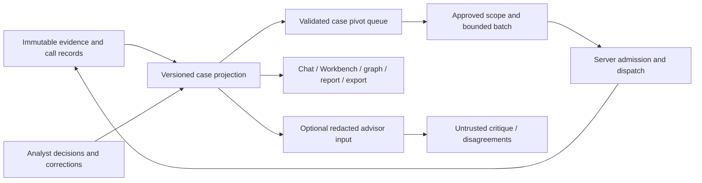

# Investigative analyst and advisor workflow — proposal

Status: planning only; implementation requires the phase-specific decisions below. Updated 2026-10-26 on `planning/agentic-workflow-proposal`, independently from regression PRs #881 and #882. No application, schema, scoring, production, secret, provider, or run-lease changes.

## Recommendation and scope

Review and release the verified shared-queue repair through its separate release process first, then expose the existing automatic assessments consistently, make corrections durable and reversible, establish execution identity and lineage, and finally offer bounded passive batches. Evaluate a second-model advisor last. Do not build another confidence engine or require routine human confirmation to keep investigation moving.

The intended experience is: open case → review purpose, allowed tools and limits → **Run recommended pivots** → observe calls, costs and changes → pause/stop/correct → review the next batch. The authorization covers a bounded batch under a versioned policy; it is not consent to unlimited follow-on work. Tool exclusions and lower limits take effect before the next dispatch. An expanded scope or budget needs a new authorization. Ordinary eligible items within the approved batch need no individual approval. Exceptions such as ambiguous identity linkage remain distinct human decisions.

Repair the existing workspace progressively. The supplied screenshots are evidence of that workspace, not a replacement visual design. They visibly show a phone icon beside an IP, a large multiline inspector heading, and a five-pivot summary during an active run. They do not show the Next tab's list, establish the deployed frontend commit, or prove that zero established connections is erroneous. Reproduce with synthetic data rather than committing screenshot case identifiers or records.

## Evidence and current state

Inspected canonical main `750e885cffb0574290abec77bb406d7c2e673927`; read AGENTS.md, CLAUDE.md, tasks/lessons.md and the documents below. Remote main still matched that SHA during planning. PR #881 is open, draft, unmerged at `763b35c6134029b181e0d87b8151a2b3ac792223`: registration filtering repair only. Its 52 targeted tests and synthetic browser verification do not establish that the whole app is fixed. The subsequent queue repair is now [draft PR #882](https://github.com/justindean785/insight-finder/pull/882), head `db660df464579b87b467855b454a5b6e2af71f45`, also unmerged. The new attachment repeats the earlier product direction; this update reconciles the proposal with the completed repair rather than expanding that patch.

| Capability | Existing implementation | Gap this proposal addresses |
|---|---|---|
| Case state | `CaseSnapshotProvider.tsx` reconciles thread, tools, artifacts, reviews and publishes versions; `useCaseSnapshot.ts` exposes hydration/sync/error | Main still has independent queue inputs; draft #882 adds one mounted `CasePivotQueueProvider`, shared validated items/count, history reconciliation and explicit unavailable states |
| Pivot planning | `pivot-engine.ts`, `recommended-pivots.ts`, `pivot-schema.ts`, `best-pivot.ts`; validation, review exclusions, ranking, skip and queried-target handling | Full recommendation sentences can remain invalid; queried target is too coarse to prove all useful actions exhausted; reasons/inputs need shared versions |
| Tool choice and execution | `tool-registry.ts`, `cache.ts`, `runtime-policy.ts`, circuits and query policies; UI run controls allow up to three continuation cycles | Current browser event dispatch is not a durable batch scheduler; `BULK_QUEUE_UNAVAILABLE` explicitly cites missing run ID/idempotency contract |
| Automatic assessment | `lib/finding-row.ts` uses `computeAxes`; recording paths use `applyRecordingSourcePolicy`; synthesis and clustering code already exist | Inconsistent projections and explanation vocabulary; deployed synthesis triggers/schema prerequisites require verification before reuse |
| Corrections | `review.ts` writes reviews, propagates decisions, invalidates cache; wrong also calls `save_agent_memories`; reset records retract | Best-effort feedback append is separate from review write; reason taxonomy, relationship corrections, atomic audit and learning scope need completion |
| Measurement | `analyst_feedback_events` migration, RPC, clean/resolved views, `calibration.ts` metrics | Source presence does not establish production installation. Labels are selected analyst judgments, not validated identity probabilities |
| Provenance | tool log, artifact metadata, evidence log and lineage proposal #613 | Stable run/call/artifact lineage and original payload retention must be proved before automated batches |
| Advisor | Existing primary/fallback orchestration and synthesis | No inspected implementation establishes a separate, capped, independently evaluated advisor with no write authority |

Overlapping drafts: #873 ranking/explanations, #874 preview-before-run, #593 authority-safe dedupe, #613 lineage schema. Recheck their status before each implementation phase; reuse reviewed contracts rather than duplicate their work. The previously paused local WIP `ea082f1` was reviewed, completed and replaced by `db660df` on `repair/case-pivot-queue` in draft #882. It is implementation-verified locally, not released or production-verified. The repair changes no ranking weights, scoring constants, provider policy, schema or run-lease setting.

### Reconcile the confidence documents with the tree

Read [CONFIDENCE_ENGINE](../CONFIDENCE_ENGINE.md), [CALIBRATION_MILESTONE](../CALIBRATION_MILESTONE.md), [confidence-corroboration](../design/confidence-corroboration.md), [analyst decision propagation](../ANALYST_DECISIONS_PROPAGATION.md), and the [October 20 plan](2026-10-20-agentic-upgrade-plan.md). These are dated measurements and proposals, not uniformly current behavior.

- **Stored evidence strength:** server `confidence.ts`, recording-source policy and `lib/finding-row.ts` remain the scoring owners. `computeAxes` now lives behind `buildFindingRow`, used by `record_finding`; the older document's inline call-site description is stale. Artifact recording and derived findings are different paths. An artifact lacking a corroboration boost does not authorize adding one.
- **Displayed number:** `display-confidence.ts` returns stored confidence clamped only by a usable recorded cap, preserving null/unknown. It discloses quarantine/minor constraints separately; these affect authority/labels. Do not reapply historical analyst deltas or reinterpret a zero cap as missing.
- **Authority:** `authority.ts` projects `evidenceStatus` and existing eligibility predicates. Machine evidence strength, subject linkage, analyst attestation and investigative priority are separate dimensions. Confirm does not release quarantine; Key does not create corroboration. Explicit linkage resolution preserves its history, and rejection still excludes a row.
- **Explanation drift:** `src/lib/confidence.ts` still constructs a source baseline and extra-source component, while `display-confidence.ts` owns the rendered number. A future explanation should disclose the actual recorded computation and missing inputs, not pretend a reconstructed sum is the engine's calculation. Taxonomy reconciliation needs an explicit comparison before changing any label or threshold.
- **Independence:** separate artifact rows, provider labels, datasets/origins and qualifying source classes. `audit/source-independence.ts` collapses source objects by origin; this is not the same metric as the engine's independent source classes. Corpus counting as corroboration was explicitly rejected in the design document. Repeated tools, mirrors, combolists, or model agreement cannot add independent support.
- **Calibration:** the existing confidence/100 conversion is a measurement convention, not proof of probabilistic validity. Report sample sizes, intervals, selection bias and model version. Key is priority, so do not silently treat it as identity ground truth merely because an older calibration view groups it with Confirm. Review label definitions and run a separate holdout evaluation before changing those views or calibrating probabilities.

The October 20 plan proposed scoring snapshots first and a large agentic phase. This proposal splits that phase and moves queue coherence ahead of scoring consolidation because its current cross-view defect is observable and a shared queue needs no new scoring engine. Retain its settled scope decisions, termination invariants and conditional synthesis prerequisites. Its old live counts, costs and migration observations must be remeasured, not quoted as today's baseline.

## Target contracts

Queue eligibility is not identity authority. Existing quarantine rules can permit a bounded investigative lookup while withholding the result's subject authority. Do not silently reverse that rule; use the existing eligibility contract and disclose the distinction. Analyst-rejected targets, policy-prohibited operations and unknown authorization state cannot enter a new autonomous dispatch.

Proposed additive records, subject to schema review:

| Record/API | Minimum contract |
|---|---|
| Case projection | case ID, monotonic revision, source watermarks, review revision, score-policy version, hydration/staleness/errors; assessment explains stored score, independent classes, contradictions, linkage, caps and citations |
| Pivot candidate | stable ID, case/revision, canonical selector type/value, action/query family, eligible tools, source artifact IDs, reason codes, coverage gaps, observed cost/latency/yield with sample sizes, lifecycle and supersession |
| Case tool policy | version, purpose/scope, enabled/excluded tools, effective time and actor; configured capability versus observed availability; no secret values |
| Correction event | actor kind and server-derived identity, target artifact/relationship/selector, old/new effective state, reason code/text, scope, timestamp, reversal reference; preserve original evidence and event history |
| Batch/run/call | stable IDs, authorization/policy revision, idempotency key, server-owned state/generation, reserved/actual cost, call count, deadlines, cancellation and outcomes; artifact lineage references exact call IDs |
| Advisor assessment | input projection/version and redaction manifest, model version, budget, critique references, disagreements and disposition; no scoring/authority write permissions |

Reuse existing tables/fields where they satisfy these contracts. Inspect actual catalog constraints/RLS and #613 before proposing new migrations. Do not backfill unknown historical lineage by matching timestamps or labels and calling it exact; label inferred/unknown links explicitly. Preserve original URL, retrieval time and restricted raw output reference through normalization and deduplication.

Proposed endpoints/RPCs: read queue/projection; compare-and-swap case policy; commit correction plus audit event; create bounded batch; pause/resume/cancel; retrieve batch events. Every mutation verifies authenticated case ownership, expected revision and allowed state transition server-side. Models propose typed candidates; deterministic validation and policy decide admission. Never accept a model-generated human actor or confirmation.

## Phased delivery and acceptance gates

### 1. Smallest useful increment: one case queue

**Repair status:** the authorized queue-coherence portion is implemented in draft #882. Against base `750e885`, a sanitized signed-in browser test reproduced a mounted transcript promising three leads while a later-opened Workbench showed two after a missed tool-log event. The repaired sequence shows two in both views and on mobile. Local results: 2,903 frontend tests passed / 1 skipped; 98 browser tests passed / 13 skipped; typecheck and build passed; lint 0 errors / 15 existing warnings. Nine queue/request-order tests exercise reviews, skips, report clearing, stale responses, case changes and reconnect. No paid investigation requests or production writes were made. Actual network partitions, two-device production runs and hosted-provider behavior remain unverified. Do not treat this as durable execution or completed batch support.

The selector-repair form, structured recommendation contract and attempt coverage by action/tool family below are follow-ups; they were **not** included in this repair. Likewise, shared UI state does not provide server-side batch idempotency or ownership.

One mounted case owner reads authoritative artifacts, seed, reviews, recommendations and queried-call history. Chat's count and every rendered queue read the same validated candidate list and revision. Refresh at run completion, reconciliation, socket resubscription, visibility return and explicit retry; suppress actions when prerequisites are unavailable. Ignore late responses from a previous case/version. Generic assistant actions get a separate label and never contribute to pivot counts.

Keep existing ranking weights, dispatch controls and validation. Legacy sentence suggestions get an explicit selector/type repair form and preview; never auto-dispatch an extracted token. Structured recommendations are the future input contract. Distinguish observed prior attempts by selector + action/tool family + outcome/time; a previously queried selector is not automatically exhausted. Defer changes to ranking semantics until approved and covered by #873/#874 integration tests.

**Gate:** zero count/target mismatches across mounted chat, late Next opening, two completed runs, reconnect, rejected/skipped candidates, changed case, reload and 390/891/1440px viewports. A failed review/history fetch produces a visible unavailable state and no enabled launch. No new paid calls, score changes or artifact writes. PR scope: queue coherence only; inspector and seed repairs remain their own small regression tasks.

### 2. Automatic assessment, consistent explanations and correlation

**Recommended next product increment:** a read-only explanation projection for existing recorded assessments, first in the evidence inspector, with parity fixtures for report/export consumers. Inventory actual metadata and source-class provenance before selecting a DTO; show missing inputs as unknown, retain the existing displayed number and authority status, and avoid reconstructing an invented score breakdown. No new scoring engine or schema migration is required unless inspection establishes a missing durable field. Deliver the projection/parity tests and one consumer in a focused PR; separate wider consumer migration, correlation changes and new persistence. Inspector readability remains an independent regression repair and can proceed without approving automation or scoring changes.

Reuse automatic normalization, source policy, finding construction, contradiction and clustering paths. Introduce a versioned read projection of those results before replacing any consumer. Compare old/new projections in shadow tests; keep recorded values immutable. Render observations, candidate relationships and established identity links distinctly. Show cycle changes separately from a full case report.

Do not infer an identity from a username, common name, image, shared password, or one matching field. Plaintext passwords must never become link keys or enter new model prompts/reports through this workflow. Restrict existing credential material to its authorized evidence paths without changing the current breach-reveal setting. A bounded reuse signal remains a lead, not identity proof.

**Gate:** every surface/export agrees for the same case revision; 48 repeated single-provider records add no independent class; unknown/blocked/malformed responses never become confirmed absence; quarantined and rejected-derived rows never enter subject claims. All existing confidence/cap/authority tests remain unchanged and pass. Numeric-policy or clustering changes require a separate proposal, fixtures and sign-off. Before enabling existing synthesis, verify live schema, trigger authentication, uniqueness, sweep behavior and dry-run results; do not simply flip flags or add work to the finalization window.

### 3. Case corrections and accountable tool adaptation

Offer namesake, wrong person, duplicate, bad extraction, unrelated account and insufficient evidence reasons. Apply case-local effective exclusions immediately and propagate to descendants, relationships, queue and exports. Failed writes roll back visibly. Undo appends a reversal and recomputes the effective view; it never deletes original evidence or history.

Extend the existing feedback mechanism rather than create another learning store. Best-effort telemetry is useful for measurement, but is insufficient as the sole durable audit of a correction: propose a transactional review/correction+event RPC with retry-safe identity. Keep machine assessments outside human confirmation rows. Review the existing Wrong→memory path before migration; distinguish a case correction from an explicitly approved cross-case lesson.

Tool performance is conditional on tool, selector kind, action, time window and availability. Show counts/uncertainty; separate empty, blocked, malformed, skipped and provider error. Use case-local recommendations first; no silent global disabling. Sparse observations fall back to existing ordering. Global policy candidates require versioned evaluations, approval, shadow rollout, a reversible activation record and explanation of scope.

**Gate:** correction/undo immediately changes all relevant views and future candidates, survives reload, and preserves evidence hashes. Duplicate requests append one effective transition; cross-case/tenant access fails. A single rejection cannot create a global rule; operational success is not assumed to mean useful evidence.

### 4. Durable bounded passive batches

Prerequisites: stable execution identity, ownership fencing, call-to-artifact lineage, atomic budget reservations and policy-aware cancellation. The existing heartbeat lease explicitly is not ownership fencing and is documented disabled. Do not re-enable or alter it as an incidental dependency; submit the required execution design separately for approval. Until that exists, the batch button stays unavailable with an honest reason.

Start with serial execution. A batch snapshots candidates and approved policy; new discoveries prepare the next batch rather than silently expand this one. Before every dispatch, recheck current exclusions/reviews, authorization, remaining limits and cancellation. Idempotency prevents duplicate admission, but cannot guarantee exactly-once upstream paid calls after a network ambiguity. Persist admission before dispatch, retain provider request IDs where possible, and mark uncertain calls for reconciliation rather than blindly retrying and risking double spend.

Limits cover total dollars, paid calls, all calls, elapsed time and retries across the entire batch, not merely each nested run. Include orchestrator/advisor costs. If a tool lacks a defensible cost bound, exclude it from a hard-budget batch until pricing/reservation support exists. Stop on budget, cancellation, unavailable authorization/history, or saturation. Pause blocks subsequent dispatch; stop requests cooperative cancellation and discloses already in-flight calls and charges. Neither promises to undo collection or spend.

**Gate:** fault-injection tests for double-click/two tabs/retry/crash/reconnect/cancel races produce no duplicate admitted run and no new call after cancellation is acknowledged. Batch remains recoverable after browser closure. Every call has an attributable terminal or explicitly uncertain state. Policy exclusions and reservations hold under concurrency. No contacts, login attempts or external-account actions. Roll out through dry-run planning and sandbox providers before a separately approved low-budget live pilot.

### 5. Optional advisor experiment

Compare (A) the current deterministic pipeline plus corrected explanations, (B) improved primary-model context/structured output, and (C) a second reviewer on identical sanitized held-out cases. Provider diversity alone is not evidence of independent reasoning or source independence.

Default off; one critique after a completed batch, never per artifact or inside finalization. Suggested experiment cap for review: one call, 10-second timeout, 2,000 input/500 output tokens, and a separately approved dollar cap that counts toward the batch total. Do not select a provider or change pins during planning. Use a minimal redacted projection of claim IDs, source classes, limitations and policy-approved excerpts; omit credentials, raw breach dumps and unnecessary identifiers. Validate redaction before sending, constrain output schema, and treat both input documents and critique as untrusted content.

The advisor can flag unsupported claims, missing alternatives and uncertainty. It cannot dispatch, promote, release quarantine, set human review state or change scores. Preserve disagreement explicitly and show it as advice pending disposition. Failure/timeout must not block a completed case.

**Gate:** blinded review on at least 50 diverse sanitized held-out cases, reporting unsupported-claim detection, false challenges, review time, cost and p95 latency versus A/B, with sample sizes and uncertainty. Zero authority mutations or prohibited data disclosures. Approve a usefulness threshold and provider/data policy before pilot; reject the extra model if benefit does not justify cost/latency.

## Verification and rollout

Use synthetic adversarial fixtures: aliases/mirrors, shared infrastructure, namesakes, active/released/rejected quarantine, negative/blocked/malformed results, nested metadata, unknown lineage, delayed/out-of-order events, reversal and multi-tenant isolation. Browser scenarios must exercise real state transitions through the signed-in harness, not only static screenshots. Assert persisted call-ID reconciliation between transcript/Tools/Overview and matching case revisions across report/export.

Track baseline and candidate versions: count mismatch rate; stale queue duration after successful reconciliation; useful eligible new evidence per paid dollar; blocked/empty/error mix; manual review actions per case; corrections repeated within a case; false identity-link rate; traceability coverage; cost/latency and cancellation latency. Suggested rollout targets: 0 observed count mismatches and authority leaks in regression suites; 100% new-call lineage; 0 admitted duplicate/cancelled work in fault injection; at least 30% fewer routine review actions on a fixed synthetic task set without increased false links. These are proposed acceptance targets, not measured product results. Do not tune confidence from yield or optimize for raw artifact volume.

Each phase uses small frontend, schema and backend PRs separately. Run targeted failing-before tests, typecheck/lint/build, frontend suite and manual e2e; edge changes also require edge tests; schema changes require PostgreSQL migration, ownership/RLS and transactional concurrency tests. Reconcile open PRs before editing. Shadow projections and feature flags provide rollback without deleting evidence/history. No merge/deploy in this planning task; retain the documented explicit backend deploy and moved-build verification workflow for later authorized releases.

## Decisions for JD before implementation

1. **Next scope:** the queue regression was already authorized and is complete in draft #882; its merge/release is not authorized here. For the larger product project, approve the read-only assessment explanation/parity increment in Phase 2. Keep inspector/seed/tool-outcome repairs and the remaining Phase 1 recommendation/coverage contracts separate. No broad automation implementation is implied.
2. **Assessment contract:** approve the projection/schema and any removal of competing display calculations only after parity evidence. Any score, threshold, cap, tier, source-class or clustering change needs separate explicit sign-off.
3. **Correction scope:** approve reason taxonomy, relationship correction/undo, atomic audit behavior, and how the existing Wrong→memory workflow transitions to explicit case-local versus cross-case learning.
4. **Execution contract:** approve durable IDs/fencing/schema, runtime ownership and cancellation semantics before batch work; explicitly resolve any dependency on run-lease behavior. No silent change to its existing setting.
5. **Batch policy:** choose supported passive tool set, monetary/call/time ceilings and which exceptions require human decisions. Existing documented victim/minor restrictions remain; do not treat the word passive as a scope exemption.
6. **Advisor pilot:** decide whether A/B evidence justifies C, then approve provider, minimal data/retention policy, caps and evaluation threshold. No provider/model changes are implied now.

Production schema installation, active synthesis settings, exact deployed frontend SHA and real per-tool yield remain unverified in this planning task. The proposal is based on inspected source and explicitly dated documentation, not a new live-data audit. No credentials or production records are needed to review or implement the first queue-coherence increment.
