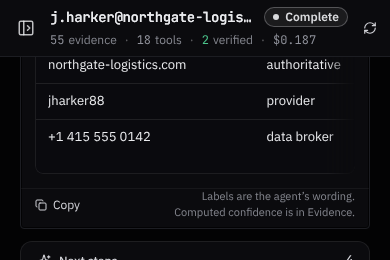
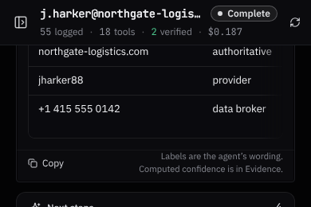

# Case bar evidence figure — before/after

Harness (`vite.harness.config.ts`), synthetic fixture, 2026-10-21. The first figure in the case bar counts
chain-of-custody entries across every run of the case (55 here), not the deduped artifacts the Evidence tab
lists (10). Before, the only place that said so was a hover tooltip. The visible word now names what is counted.

| Width | Before | After |
|---|---|---|
| 1440 |  |  |
| 390 |  |  |

- Desktop: `55 evidence` → `55 evidence logged`.
- Phone strip (one row, wraps and drops lowest-priority figures first): `55 evidence` → `55 logged`.
- The tooltip is unchanged. No count, scoring or snapshot logic changed.
