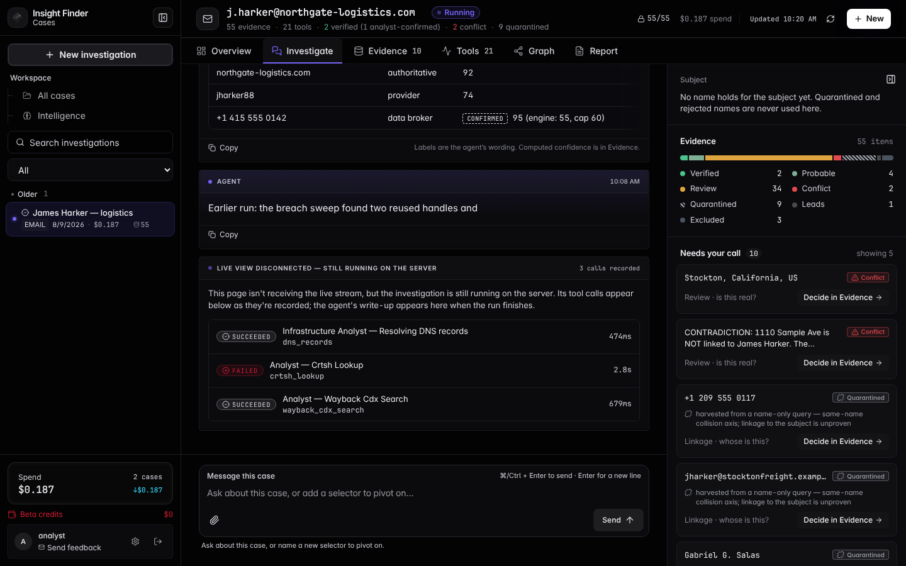
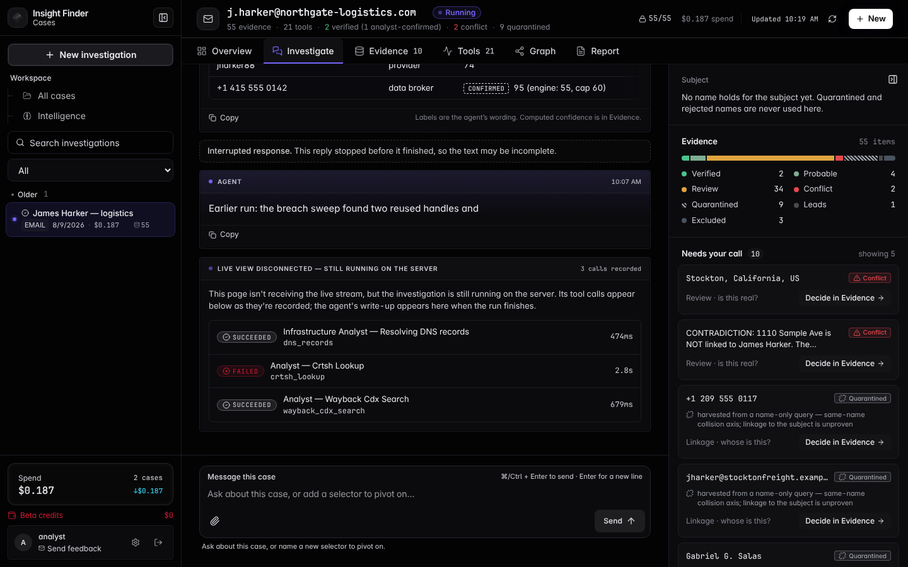
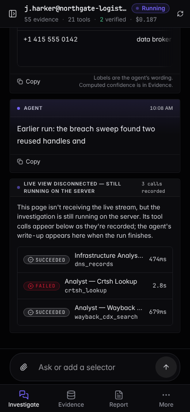
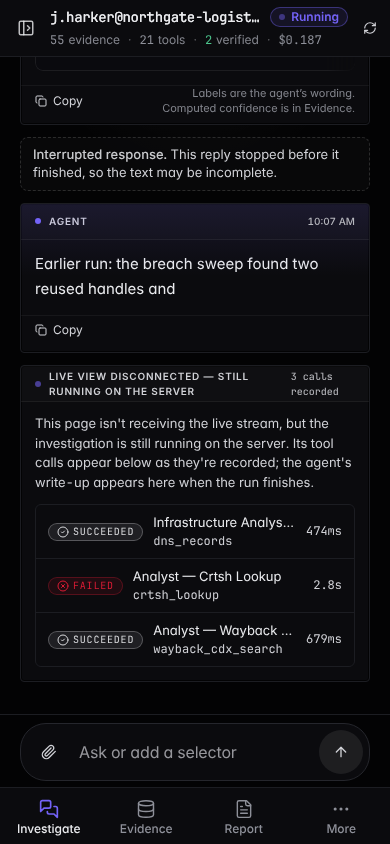
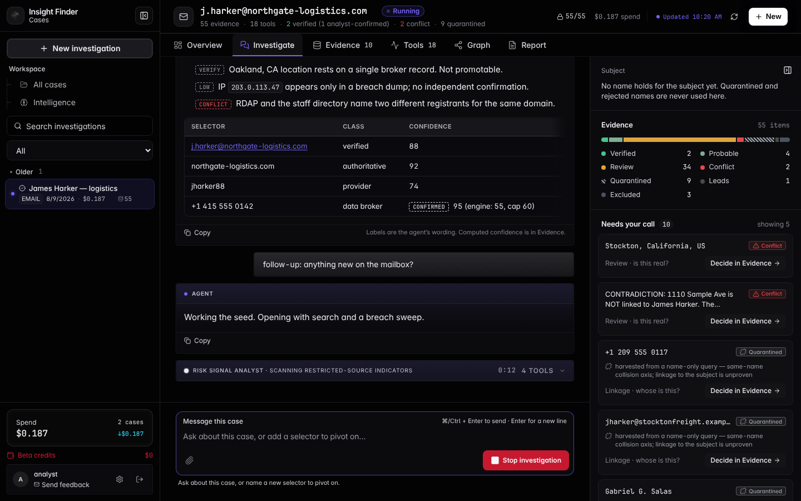
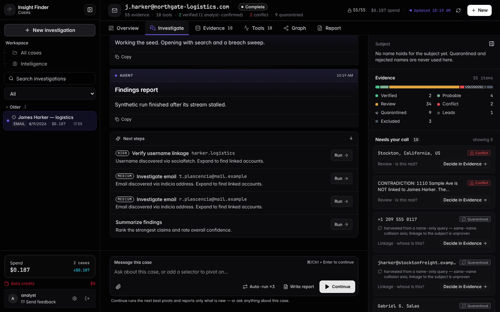

# #811 — before / after (harness, synthetic data)

Both captured from the UI harness (`npx vite --config vite.harness.config.ts`), never from production.

## Other tab: the previous run's reply while a new run is followed from the server

`?scenario=running-elsewhere`. Before: the earlier run's cut-off reply loses its "Interrupted response" label and its tool cards for the length of the new run. After: it keeps them, and the panel lists the new run's three calls.

| Before (1440) | After (1440) |
|---|---|
|  |  |

| Before (390) | After (390) |
|---|---|
|  |  |

## Stalled stream: 12 seconds after the run finished with no realtime event

`?scenario=stalled`. Before: still Running, the live card stuck, no report. After: Complete, the saved report loaded, the composer back to its idle state.

| Before (1440) | After (1440) |
|---|---|
|  |  |
